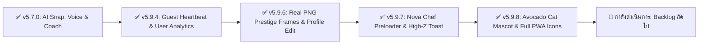

# 🗺️ NovaFit Pro - Product Roadmap & Future Feature Backlog

> **เอกสารรวบรวมแผนผังการพัฒนาฟีเจอร์และสถาปัตยกรรมระบบสำหรับอนาคต**  
> *บันทึกสถานะ ณ เวอร์ชัน v5.9.8 | อัปเดตล่าสุด: 23 ตุลาคม 2026*  
> ข้อมูลในเอกสารนี้ซิงค์อยู่บน GitHub เพื่อให้สลับไปทำงานระหว่างคอมพิวเตอร์ Mac และ Windows ได้ต่อเนื่อง 100%

---

## 🧭 ประวัติและสถานะโครงการ (Current Project Status)

---

## 🐾 เสาหลักที่ 1: ระบบสัตว์เลี้ยงคู่คิดและการพัฒนาร่าง (Gamification Pet Evolution)

### 1.1 สถาปัตยกรรมการเชื่อมโยงข้อมูล (Account & State Architecture)
* **Guest Session**: เริ่มต้นเลือกไข่และเลี้ยงน้องได้ทันที ข้อมูลบันทึกลงในเครื่อง (`localStorage`)
* **Google Account**: ซิงค์ระดับเลเวล, ค่าความสุข, ร่างของสัตว์เลี้ยงขึ้น Cloud Firestore (`users/{uid}/petData`) เปลี่ยนอุปกรณ์เล่นต่อได้ทันที ข้อมูลไม่สูญหาย

### 1.2 การดูแลน้องตามพฤติกรรมจริง (Nourishment & Activity Engine)
* 🥗 **บันทึกอาหาร**: เพิ่มค่าความอิ่มและค่า Exp สะสมเลเวลให้น้อง
* 💧 **ดื่มน้ำ**: เติมค่าความสดชื่นให้น้องมีชีวิตชีวาและแฮปปี้
* 🏃 **ออกกำลังกาย**: น้องสวมชุดวอร์มหรือมีออร่าไฟลุกพร้อมลุย

### 1.3 สามสายพันธุ์สัตว์เลี้ยง (3 Unique Archetypes)
1. 🔥 **สายเบิร์น / คาร์ดิโอ (Blaze Archetype)**:
   * บุคลิก: ว่องไว ซุกซน กระตุ้นการเผาผลาญไขมันและก้าวเดิน
   * เส้นทางการพัฒนาร่าง: Day 1 (ไข่เพลิง) ➔ Day 3 (กระต่ายไฟจิ๋ว) ➔ Day 7 (จิ้งจอกเพลิง) ➔ Day 21 (จิ้งจอกสายฟ้า) ➔ Day 60+ (พญาฟีนิกซ์ทองคำ)
2. 💪 **สายพลัง / กล้ามเนื้อ (Titan Archetype)**:
   * บุคลิก: สุขุม หนักแน่น คอยเตือนการกินโปรตีนซ่อมแซมกล้ามเนื้อและเวทเทรนนิ่ง
   * เส้นทางการพัฒนาร่าง: Day 1 (ไข่หินผา) ➔ Day 3 (ลูกหมีหิน) ➔ Day 7 (กอริลลาเทรนเนอร์) ➔ Day 21 (สิงโตไททันเกราะหิน) ➔ Day 60+ (เทพพิทักษ์สิงโตทองคำ)
3. 🌱 **สายบาลานซ์ / สุขภาพ (Zen Archetype)**:
   * บุคลิก: อ่อนโยน สงบ เน้นการคุมอาหาร ดื่มน้ำ และนอนหลับพักผ่อน
   * เส้นทางการพัฒนาร่าง: Day 1 (ไข่พฤกษา) ➔ Day 3 (เพนกวินต้นอ่อน) ➔ Day 7 (กวางป่าสายธาร) ➔ Day 21 (กวางพฤกษาเขากระจ่าง) ➔ Day 60+ (มังกรพฤกษาศักดิ์สิทธิ์)

### 1.4 กลไกปกป้องความรู้สึกและเซฟสตรีค (Streak Freeze & Recovery)
* 🛡️ **Streak Freeze (โล่น้ำแข็ง)**: แจกฟรีเดือนละ 1–2 ครั้ง หากติดธุระด่วนจนลืมบันทึก น้องจะไม่เหี่ยวเฉาหรือลดร่าง
* 🩹 **Make-up Log (ภารกิจชดเชย)**: เมื่อเข้าแอปและบันทึกย้อนหลัง น้องจะกลับมาร่าเริงสดใสเหมือนเดิมทันที

---

## 🔔 เสาหลักที่ 2: ระบบ Web Push Notifications ผ่าน Firebase (FCM)

> [!IMPORTANT]
> ระบบ NovaFit Pro เชื่อมต่อกับ **Firebase Cloud Firestore & Authentication** อยู่แล้ว การต่อยอดด้วย **Firebase Cloud Messaging (FCM)** ผ่าน Service Worker (`sw.js`) สามารถทำได้อย่างเต็มประสิทธิภาพและไม่มีค่าใช้จ่ายเพิ่มเติม

### 2.1 ความพร้อมในการรองรับบนมือถือทั้ง 2 ระบบ (Cross-Platform Mobile Support)
* 🤖 **Android OS (Google Chrome / Chromium PWA)**:
  * รองรับ 100% ทั้งผ่านเบราว์เซอร์และเมื่อกดเพิ่มลงหน้าจอหลัก แม้ปิดแอปไปแล้ว ระบบ Service Worker ในเครื่องสามารถถูกปลุกขึ้นมาแจ้งเตือนได้ตลอดเวลา
* 🍏 **iPhone / iPad (iOS 16.4+ Web Push)**:
  * Apple รองรับการแจ้งเตือน Web Push เต็มรูปแบบ โดยมีเงื่อนไขเดียวคือ **ผู้ใช้ต้องกด "เพิ่มไปยังหน้าจอหลัก" (Add to Home Screen)** เมื่อเปิดแอปจากหน้าจอหลักแล้วกดยอมรับสิทธิ์ (Allow) ข้อความจะเด้งบน **Lock Screen, แบนเนอร์ด้านบน, Notification Center และสั่นเตือนบน Apple Watch** ได้ทันที

### 2.2 กำหนดเวลาและข้อความแจ้งเตือนที่ออกแบบไว้ (Smart Notification Schedule)
* ⏰ **เตือนบันทึกมื้ออาหาร (Meal Reminders)**:
  * `08:30 น.` (เช้า): *"☀️ อรุณสวัสดิ์ครับ! เช้านี้ทานอะไร อย่าลืมถ่ายรูป AI Snap บันทึกแคลอรีกันนะ"*
  * `12:30 น.` (เที่ยง): *"🍱 ได้เวลาพักเที่ยงแล้ว! เติมพลังแล้วมาเช็คโปรตีนกัน"*
  * `19:00 น.` (เย็น): *"🥗 สรุปยอดมื้อเย็น วันนี้โปรตีนถึงเป้าหมายหรือยังเอ่ย?"*
* 🔥 **เตือนรักษาสถิติสตรีค (Streak Saver Notification)**:
  * `20:30 น.` (ค่ำ): *"⚠️ วันนี้ยังไม่ได้บันทึกอาหารเลย! เข้ามาบันทึก 1 เมนูเพื่อรักษาสถิติต่อเนื่อง [X] วันกันเถอะ"*
* 💧 **เตือนจิบน้ำ & ชั่งน้ำหนัก**:
  * เตือนจิบน้ำระหว่างวัน หากพบว่าดื่มน้ำต่ำกว่า 50% ในช่วงบ่าย
  * เตือนชั่งน้ำหนักทุกเช้าวันอาทิตย์เพื่ออัปเดตค่า TDEE/BMR ให้แม่นยำ
* 📢 **บรอดคาสต์ส่งถึงทุกคนจาก Admin Dashboard**:
  * แอดมินสามารถพิมพ์ข้อความและกดยิง Web Push จากหน้า Admin สู่หน้าจอล็อกของผู้ใช้ทุกคนได้ทันที

---

## 🎁 เสาหลักที่ 3: ระบบสิทธิประโยชน์และรางวัลรายวัน (Daily Rewards & Perks)

* 📦 **Daily Mystery Box (กล่องของขวัญประจำวัน)**:
  * สุ่มเปิดกล่องเมื่อล็อกอินและบันทึกอาหารสำเร็จในแต่ละวัน
  * รางวัล: ตั๋วสแกนอาหาร AI พิเศษ, ธีมสีแอปใหม่, โล่น้ำแข็ง Streak Freeze
* 💎 **สิทธิประโยชน์ตามระดับสตรีค (Streak Perks)**:
  * **สตรีค 7 วัน**: ตั๋วสแกนอาหารด้วย AI เพิ่มพิเศษทันที
  * **สตรีค 14 วัน**: ปลดล็อกธีมสีแอปสุดพิเศษ (เช่น Cyber Neon, Sakura Gold)
  * **สตรีค 30 วัน**: ปลดล็อกโควตาสแกนอาหารรายวันเพิ่มถาวร +3 ครั้ง/วัน
  * **สตรีค 60+ วัน**: การ์ดแชร์ IG สตอรี่ขอบทองคำเรืองแสงระดับ Legendary

---

## 👑 เสาหลักที่ 4: แผนงานระบบ VIP Tier & การส่งออกรายงานสุขภาพ

* 💳 **ระบบสมาชิก VIP / Premium Pass**:
  * โควตาสแกนอาหาร AI และสั่งการด้วยเสียงไม่จำกัด (Unlimited AI Snap & Voice Logs)
  * เข้าถึงกรอบโปรไฟล์และคอสตูมสัตว์เลี้ยงระดับพรีเมียม
  * รายงานวิเคราะห์สารอาหารเชิงลึกรายเดือน (Micro-nutrients, Sodium, Sugar Analysis)
* 📑 **ระบบพิมพ์รายงานสุขภาพส่งแพทย์/เทรนเนอร์ (PDF / Smart Doctor Summary)**:
  * รวบรวมสถิติน้ำหนัก แคลอรีเฉลี่ย สารอาหารหลัก 30–90 วัน เป็นไฟล์เอกสาร PDF พร้อมพิมพ์หรือส่งต่อให้แพทย์และเทรนเนอร์

---

## 🗄️ เสาหลักที่ 5: ระบบจัดการฐานข้อมูลอาหารหลังบ้าน (Admin Central Food Database)

* 🥗 **CRUD Central Food Management**:
  * แอดมินสามารถเพิ่ม, แก้ไขแคลอรี/สารอาหาร, หรือลบเมนูอาหารในฐานข้อมูลกลางได้โดยตรงจากหน้า Admin Dashboard
  * ผู้ใช้ทุกคนจะได้รับเมนูอาหารที่อัปเดตใหม่ทันทีผ่าน Cloud Sync โดยไม่ต้องรออัปเดตแอป

---

## 🗓️ ลำดับความสำคัญในการพัฒนาต่อไป (Prioritized Implementation Order)

| ลำดับ | รายการฟีเจอร์ | ระดับความสำคัญ | ความพร้อมของระบบ |
| :---: | :---| :---: | :---: |
| **Step 1** | **ระบบ Web Push Notification (FCM)**: ขอสิทธิ์และตั้งเวลาเตือนมื้ออาหาร + Streak Saver | 🔴 สูงสุด (High Impact) | มี Firebase + Service Worker พร้อมอยู่แล้ว |
| **Step 2** | **ระบบสัตว์เลี้ยงคู่ใจ (Pet Evolution Phase 1)**: เลือกระบบไข่ ➔ ฟักตัวตามสตรีค 3-7 วัน | 🟡 สำคัญมาก (High Engagement) | ต้องเตรียมภาพ Asset น้อง 3 สาย |
| **Step 3** | **Daily Rewards & Mystery Box**: กล่องสุ่มรางวัลรายวันฉลองสตรีค | 🟢 ปานกลาง | โค้ด Streak และ Confetti พร้อมใช้งานแล้ว |
| **Step 4** | **Admin Central Food DB Management**: แอดมินเพิ่ม/แก้เมนูอาหารจาก Dashboard | 🟢 ปานกลาง | โครงสร้าง Admin Dashboard เดิมรองรับได้ทันที |
| **Step 5** | **VIP Tier & Smart PDF Report**: ระบบสมาชิกพรีเมียมและพิมพ์รายงาน | ⚪ แผนงานอนาคต | เตรียมเชื่อมต่อระบบชำระเงินในขั้นต่อไป |
